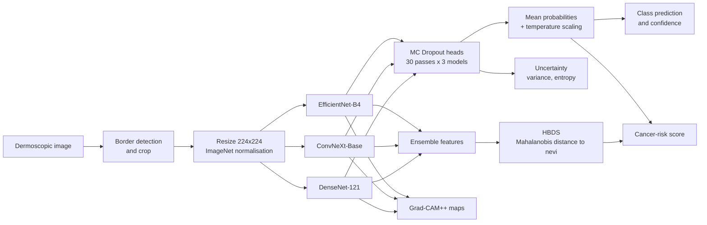
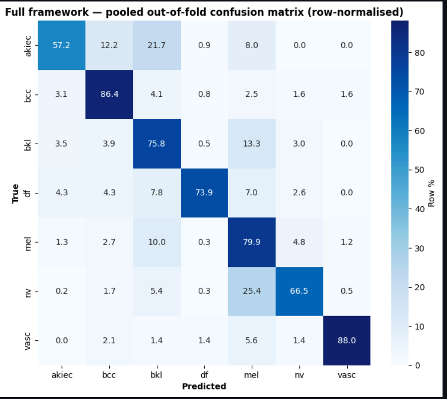
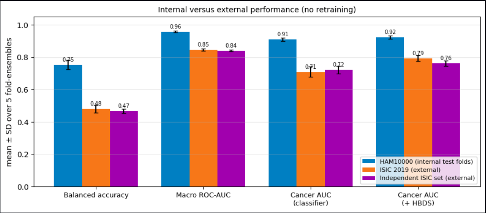

# Uncertainty-Aware Skin Lesion Classification under Domain Shift


A deep-learning framework for **seven-class dermoscopic skin lesion classification** that combines a heterogeneous CNN ensemble
(EfficientNet-B4, ConvNeXt-Base, DenseNet-121) with **Monte Carlo Dropout**, **temperature scaling**, a novel
**Histopathology-Inspired Benign Deviation Score (HBDS)** and **Grad-CAM++** explanations. The models are trained on HAM10000
with **lesion-grouped cross-validation** and tested **without retraining on two external ISIC datasets**, followed by a
systematic analysis of why performance drops on images from other institutions.

> **Research project.** This is not a medical device and has not been clinically validated. Its outputs must not be used to make
> diagnostic or treatment decisions.

---

## Highlights

- **Leakage-free evaluation.** HAM10000 contains 10,015 images of only 7,470 lesions. In a conventional image-level split,
  **40.5% of test images (609 of 1,503) shared a lesion with training or validation images**. All results here use
  lesion-grouped, stratified 5-fold cross-validation instead.
- **Ensemble with uncertainty.** Internally, the ensemble reaches **75.4 ± 3.0% balanced accuracy** and **0.958 macro ROC-AUC**,
  above every single backbone, and it exceeded the best single model in all five folds on all three test sets.
- **Benign Deviation Score (HBDS).** A Mahalanobis distance of ensemble features from a reference set of benign nevi. Combined
  with the classifier, it raised the cancer-vs-benign ROC-AUC on external ISIC 2019 data from **0.710 to 0.794**
  (gain 95% CI +0.074 to +0.095), more than five times its internal gain.
- **External validation and failure analysis.** Tested on **4,859 ISIC 2019 images** and an **independent set of 3,134
  images**. A failure analysis found no evaluation error or leakage and identified dark dermoscope borders as one cause; an
  automatic **border-crop policy raised balanced accuracy by 9.2 points** on previously unused bordered images.
- **25x faster uncertainty estimation.** The backbones contain no dropout, so MC Dropout can sample only the classification heads
  on features computed once. This gives **identical outputs** and cuts GPU latency from **1,695 ms to 67 ms per image**.

---

## Pipeline



All fitted quantities (temperature, uncertainty threshold, HBDS reference statistics and levels, risk-score weights and operating
points) are estimated on the **validation partition of each fold only**; no test or external labels are used for any choice.

---

## Results

All internal numbers are mean ± standard deviation over the five lesion-grouped test folds. Full tables are in [`results/`](results/).

### Internal performance (HAM10000, 5-fold CV)

| Model | Balanced acc. (%) | Macro F1 (%) | Macro ROC-AUC | Cancer-vs-benign AUC | ECE |
|---|---:|---:|---:|---:|---:|
| EfficientNet-B4 | 71.51 ± 3.10 | 61.64 ± 4.10 | 0.937 ± 0.008 | 0.881 ± 0.020 | 0.079 |
| ConvNeXt-Base | 71.83 ± 3.31 | 68.59 ± 1.75 | 0.942 ± 0.015 | 0.896 ± 0.013 | 0.089 |
| DenseNet-121 | 73.19 ± 1.79 | 61.49 ± 2.07 | 0.943 ± 0.005 | 0.887 ± 0.005 | 0.094 |
| Ensemble (soft vote) | 75.41 ± 2.95 | 68.37 ± 2.38 | 0.958 ± 0.005 | 0.911 ± 0.011 | 0.080 |
| **Ensemble + MC Dropout + temperature scaling** | **75.41 ± 3.01** | **68.38 ± 2.39** | **0.958 ± 0.005** | 0.909 ± 0.010 | **0.079** |

Balanced accuracy (the mean of per-class recall) is the primary metric because melanocytic nevi make up 66.9% of HAM10000.

<p align="center"></p>

### External validation (no retraining)

| Metric | HAM10000 (internal) | ISIC 2019 (4,859 images) | Independent ISIC set (3,134 images) |
|---|---:|---:|---:|
| Balanced accuracy | 0.754 ± 0.030 | 0.481 ± 0.024 | 0.468 ± 0.013 |
| Macro ROC-AUC | 0.958 ± 0.005 | 0.848 ± 0.007 | — |
| Cancer-vs-benign AUC (classifier) | 0.909 ± 0.010 | 0.710 ± 0.033 | 0.723 ± 0.023 |
| Cancer-vs-benign AUC (classifier + HBDS) | 0.924 ± 0.009 | **0.794 ± 0.018** | **0.763 ± 0.017** |
| ECE | 0.079 ± 0.027 | 0.138 ± 0.037 | 0.135 ± 0.041 |

<p align="center"></p>

### Why performance drops externally

| Experiment | Result | Conclusion |
|---|---|---|
| Verification of labels, preprocessing, checkpoints and metrics | Results reproduced exactly; no HAM10000 duplicates in the external data | The drop is real |
| Border crop, pre-specified rule, 554 unused bordered images | 31.6% → 40.8% (+9.2 pp, 95% CI 6.2 to 12.8) | Dermoscope borders harm predictions |
| Same policy, full ISIC 2019 sample | 48.1% → 50.6% (+2.5 pp, CI 1.7 to 3.5) | Partial fix |
| Shades-of-Gray colour constancy | −1.4 pp | Not helpful |
| Prior (class-frequency) adjustment | −3.1 pp | Harmful |
| Stronger training augmentation, 3 seeds | −1.9 pp | No benefit |
| Linear probe on frozen features trained with external labels (diagnostic only) | 58.0% | Both features and decision layer limit generalisation |

### Uncertainty and inference cost

- Ranking cases by `1 − max probability` detected errors better than MC Dropout variance (error-detection AUC 0.828 vs 0.599
  internally), but every threshold fitted on HAM10000 transferred poorly to external data.
- Head-only MC Dropout: **66.9 ms** per image on an RTX 4050 Laptop GPU, against **1,694.6 ms** for 90 full forward passes, with
  identical outputs. See [`results/timing_results.csv`](results/timing_results.csv).

---

## Dataset

| Dataset | Role | Images | Source |
|---|---|---:|---|
| HAM10000 | Training and 5-fold internal evaluation | 10,015 (7,470 lesions, 7 classes) | [Harvard Dataverse](https://doi.org/10.7910/DVN/DBW86T) |
| ISIC 2019 (HAM10000 images removed) | External test | stratified sample of 5,000; 4,859 in the 7 HAM classes | [ISIC Challenge](https://challenge.isic-archive.com/data/) |
| Independent ISIC set | Second external test, lesion-disjoint from the above | 3,134 | ISIC Archive |

Classes: actinic keratosis / intraepithelial carcinoma (akiec), basal cell carcinoma (bcc), benign keratosis (bkl),
dermatofibroma (df), melanoma (mel), melanocytic nevus (nv), vascular lesion (vasc).

**Images are not included in this repository.** HAM10000 and the ISIC 2019 data are distributed under the non-commercial
CC BY-NC 4.0 licence; download them from the official sources above and cite them as requested there. The lesion-grouped fold
assignment (image identifiers only) is provided in [`splits/`](splits/).

---

## Method

| Component | Setting |
|---|---|
| Input | 224 × 224 RGB, ImageNet normalisation |
| Augmentation | Flips, rotation, affine, colour jitter, Gaussian noise and blur, gamma, CLAHE, coarse dropout ([Albumentations](https://albumentations.ai/)) |
| Backbones | EfficientNet-B4, ConvNeXt-Base, DenseNet-121, ImageNet pre-trained ([timm](https://github.com/huggingface/pytorch-image-models)) |
| Head | LayerNorm → Dropout 0.4 → Linear 512 → GELU → Dropout 0.2 → Linear 7 |
| Class imbalance | Weighted random sampler + class-weighted focal loss (γ = 2.5) with label smoothing 0.1 |
| Optimisation | AdamW (lr 3e-4, weight decay 1e-4), batch 32, mixed precision, cosine annealing with warm restarts |
| Stopping | Up to 30 epochs, early stopping on validation macro AUC (patience 10) |
| Uncertainty | MC Dropout, 30 passes per model (90 samples per image) |
| Calibration | Temperature scaling fitted on each fold's validation set |
| HBDS | Ledoit–Wolf Mahalanobis distance to training nevi, 3-level Gaussian mixture |
| Explainability | Grad-CAM++ ([pytorch-grad-cam](https://github.com/jacobgil/pytorch-grad-cam)), compared with expert lesion masks |
| Statistics | Bootstrap confidence intervals resampling lesion clusters (2,000 replicates) |

---

## Repository structure

```
├── README.md
├── requirements.txt
├── LICENSE
├── predict.py                  # inference on one image or a folder
├── splits/
│   └── lesion_grouped_folds.csv
├── notebooks/
│   ├── 01_data_and_splits.ipynb          # dataset, leakage audit, lesion-grouped folds
│   ├── 02_training.ipynb                 # 3 backbones x 5 folds
│   ├── 03_internal_evaluation.ipynb      # ensemble, MC Dropout, calibration, metrics
│   ├── 04_hbds.ipynb                     # benign deviation score and cancer-risk score
│   ├── 05_gradcam.ipynb                  # Grad-CAM++ and localisation against lesion masks
│   ├── 06_inference_speed.ipynb          # head-only vs full MC Dropout
│   ├── 07_external_validation.ipynb      # ISIC 2019 and independent set
│   └── 08_failure_analysis.ipynb         # border crop and other domain-shift experiments
└── results/
    ├── internal_results.csv
    ├── external_results.csv
    ├── hbds_results.csv
    ├── border_crop_results.csv
    ├── timing_results.csv
    ├── confusion_matrix.png
    └── external_vs_internal.png
```

---

## Installation

```bash
git clone https://github.com/<your-username>/skin-lesion-classification.git
cd skin-lesion-classification
python -m venv .venv
source .venv/bin/activate            # Windows: .venv\Scripts\activate
pip install -r requirements.txt
```

For GPU support, install PyTorch for your CUDA version from [pytorch.org](https://pytorch.org/get-started/locally/) before the
remaining requirements. The experiments were run on an NVIDIA GeForce RTX 4050 Laptop GPU; inference also runs on a CPU.

## Usage

### Predict

```bash
# one image
python predict.py --image path/to/lesion.jpg --weights-dir checkpoints

# a folder of images, saved to CSV
python predict.py --image path/to/folder --weights-dir checkpoints --output predictions.csv
```

Example output format:

```
lesion.jpg
  prediction : <class name> (<code>), confidence <p>
  top 3      : <class> <p>, <class> <p>, <class> <p>
  P(akiec + bcc + mel) <p> | MC variance <v> | entropy <h> | <border handling>
```

Options: `--folds` (fold ensemble to use, default `0`), `--temperature` (calibration temperature), `--no-border-crop`,
`--mc-samples`, `--device`. Run `python predict.py -h` for details.

### Reproduce the experiments

1. Download the datasets (see [Dataset](#dataset)) and set the paths at the top of each notebook.
2. Run the notebooks in order, `01` to `08`. Notebook `02` trains the 15 models (3 backbones × 5 folds); the later notebooks
   evaluate them and write the tables in `results/`.

Training uses fixed seeds, but GPU non-determinism means retrained models can differ: three retrainings of the same
configuration gave external balanced accuracies between 0.481 and 0.502. The ensemble reduces this variation.

## Pretrained weights

<!-- Replace this paragraph with the download link and SHA-256 checksums once the checkpoints are hosted. -->
The trained checkpoints are not included in this repository because of their size. `predict.py` expects them in the layout
`checkpoints/fold{k}/{efficientnet_b4,convnext_base,densenet121}.pth`. Because they were trained on CC BY-NC data, the weights
are for non-commercial research use only.

---

## Limitations and responsible use

- **Not clinically validated.** The models were evaluated retrospectively on public archives only.
- **Domain shift.** Balanced accuracy fell from 75.4% internally to 46.8–48.1% on external data. Thresholds and calibration
  fitted on HAM10000 did not transfer, so any deployment would need local validation and recalibration.
- **Dataset bias.** All training data come from one public dataset, which under-represents darker skin types; performance on
  other skin types and acquisition devices is unknown.
- **Class imbalance.** Rare classes (dermatofibroma and vascular lesions, about 1% each) have few test examples, and the most
  frequent error is classifying nevi as melanoma.
- **Explanations are not proof.** Grad-CAM++ maps show where the models looked, not that their reasoning is clinically correct.

## Authors

Satarupa Mishra, Antik Sen, Shrey Tank

<!-- Add each author's main contributions here, e.g. "training pipeline", "external validation", "HBDS". -->

## Citation

A manuscript describing this work is in preparation. Until then, please cite this repository:

```bibtex
@misc{mishra2026skinlesion,
  title  = {Uncertainty-Aware Skin Lesion Classification under Domain Shift},
  author = {Mishra, Satarupa and Sen, Antik and Tank, Shrey},
  year   = {2026},
  url    = {https://github.com/TheProgrammer400/skin-lesion-classification}
}
```

## Acknowledgements

- Tschandl, P., Rosendahl, C., and Kittler, H. *The HAM10000 dataset, a large collection of multi-source dermatoscopic images of
  common pigmented skin lesions.* Scientific Data 5, 180161 (2018).
- Combalia, M. et al. *BCN20000: Dermoscopic lesions in the wild.* arXiv:1908.02288 (2019); Codella, N. et al. *Skin lesion
  analysis toward melanoma detection.* ISBI 2018. (ISIC 2019 data)
- Pre-trained models from [timm](https://github.com/huggingface/pytorch-image-models); Grad-CAM++ from
  [pytorch-grad-cam](https://github.com/jacobgil/pytorch-grad-cam); augmentation with [Albumentations](https://albumentations.ai/).

## License

The code is released under the [MIT License](LICENSE). The datasets and any trained weights are subject to their own
non-commercial licences (see [Dataset](#dataset) and [Pretrained weights](#pretrained-weights)).
